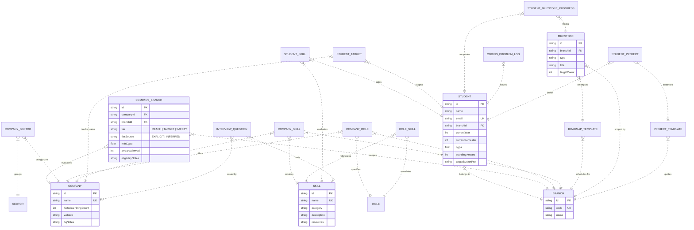

# PlacementPrep 🎓

> **A student-friendly, branch-tailored engineering placement preparation and progress-tracking platform for college students (VIT Vellore campus context).**

PlacementPrep answers the three fundamental questions every engineering student faces:
1. **Which companies should I target for my branch, and how realistic are they?** (Company Directory with branch-specific tiers, alumni hiring volume, and eligibility cutoffs)
2. **What skills do I need for those roles?** (Relational Skill Mapping & "My Skill Gap" algorithmic engine)
3. **Am I on track?** (Interactive Progress Tracker with semester roadmaps, coding counters, and project checklists)

---

## 1. Tech Stack Rationale

- **Frontend & App Framework:** **Next.js 14 (App Router)** with **TypeScript** and **React 18**. Provides rapid server-rendered initial loads, streaming data fetching, and high-performance client interactivity. Styling is driven by **Tailwind CSS** with a custom accessible design token system (dark/light mode, mobile-first responsive grid down to 360px).
- **Backend Architecture:** Unified Next.js API Route Handlers. A modular monolith architecture eliminates cross-service deployment complexity, allows shared TypeScript types and pure calculation utilities between client and server, and easily handles thousands of student requests with zero latency penalty.
- **Database & ORM:** Relational **SQLite (via Prisma ORM)** for zero-configuration, zero-dependency local development and testing, effortlessly swappable to **PostgreSQL** in production by updating the Prisma provider and `DATABASE_URL`. Explicit many-to-many join tables with cascading foreign keys and indexes model real-world branch-dependent tiers and skill mappings.
- **Authentication:** Stateless, cryptographically signed HMAC-SHA256 session tokens stored in secure HTTP-only cookies, paired with bcrypt-hashed passwords. A pre-seeded demo student (`student@vit.ac.in`) enables instant, zero-friction exploration.
- **State Management:** **Zustand** client store paired with optimistic UI updates. Toggling a milestone updates checkboxes and progress bars immediately, syncing to the API in the background with automatic rollback on network failure.

---

## 2. Entity-Relationship (ER) Architecture

PlacementPrep models real campus recruitment dynamics, where a company's tier, role offerings, and required competencies depend heavily on the candidate's degree branch (e.g. Amazon is a *Target* for CSE and *Safety/Non-Core* for Chemical; Texas Instruments is a *Target* for ECE and not visiting Biotech).



---

## 3. Project Directory Structure

```
placement-prep/
├── prisma/
│   ├── dev.db                      # Local SQLite database
│   └── schema.prisma               # Normalized relational schema with foreign keys & indexes
├── seed/
│   ├── normalizer.ts               # Data cleaner: trailing numbers, aliases, dedupe & ambiguous flags
│   ├── seed.ts                     # Master idempotent database seed runner
│   └── data/
│       ├── branches.seed.ts        # Data-driven branch catalog (CSE, MECH, BIOTECH, CHEM, ECE)
│       ├── sectors.seed.ts         # 17 industry sectors
│       ├── roles.seed.ts           # Standardized campus entry roles
│       ├── skills.seed.ts          # 50 cross-branch technical & aptitude competencies
│       ├── companies.seed.ts       # Core company seed catalog
│       ├── additional-companies.seed.ts # Full 25 ECE, Mech, and Biotech/Chem employers
│       ├── roadmaps.seed.ts        # 4-year semester roadmaps and milestones
│       ├── projects.seed.ts        # High-impact resume project templates
│       └── interview-questions.seed.ts # Practice technical & fundamental questions
├── src/
│   ├── app/
│   │   ├── api/                    # RESTful Next.js Route Handlers
│   │   │   ├── auth/               # Login, register, session me, logout
│   │   │   ├── branches/           # Data-driven branch catalog
│   │   │   ├── companies/          # Search, filters (branch, tier, sector, hiring), company detail
│   │   │   ├── skills/             # Relational skill matrix & algorithmic skill-gap calculator
│   │   │   └── student/            # Profile, targets, skills, milestones, coding logs, projects
│   │   ├── globals.css             # Tailwind design tokens, custom badges & dark mode variables
│   │   ├── layout.tsx              # Root HTML shell & meta
│   │   └── page.tsx                # Master responsive application viewport
│   ├── components/
│   │   ├── Navbar.tsx              # Top header with live branch switcher & dark mode
│   │   ├── ProfileModal.tsx        # Student preferences, CGPA, arrears, & target bucket editor
│   │   ├── dashboard/              # Readiness ring, timeline, next up milestones, 4-wk plan
│   │   ├── companies/              # Directory grid, filter toolbar, & slide-over detail drawer
│   │   ├── skills/                 # Skills matrix tabs & "My Skill Gap" sequential roadmap
│   │   └── progress/               # Semester roadmaps, coding counters, & project checklists
│   └── lib/
│       ├── auth.ts                 # Cryptographic HMAC session generator & verifier
│       ├── db.ts                   # Cached Prisma Client instance
│       ├── progress.ts             # Pure mathematical placement readiness percentage selector
│       ├── skill-gap.ts            # Demand-weighted skill gap algorithm & sequential learning sorter
│       ├── store.ts                # Global Zustand client state
│       └── utils.ts                # Tailwind clsx utility
└── tests/
    ├── sanity.test.ts              # System health & runner verification
    ├── normalizer.test.ts          # String cleaning, typo resolution & subsidiary preservation tests
    ├── progress.test.ts            # Pure placement readiness mathematical calculations
    ├── skill-gap.test.ts           # Skill gap scoring, match percentage & learning phase tests
    └── milestone-api.test.ts       # Full integration test for milestone check-off API
```

---

## 4. Local Setup & Execution Guide

### Prerequisites
- Node.js 18+ or 20+
- npm 9+

### Step 1: Install Dependencies
```bash
npm install
```

### Step 2: Environment Configuration
Create a `.env` file in the project root (a `.env.example` is provided):
```env
DATABASE_URL="file:./dev.db"
JWT_SECRET="placement-prep-vit-secret-2026"
PORT=3000
```

### Step 3: Initialize Database Schema
Generate Prisma client and push the schema to SQLite:
```bash
npm run db:push
```

### Step 4: Run the Idempotent Data Seed Pipeline
Load the full placement guide datasets (CSE, Mechanical, Biotech/Chemical, ECE):
```bash
npm run seed
```
This cleans messy corporate strings, merges duplicates while keeping maximum alumni counts, flags distinct corporate subsidiaries, and prints a comprehensive seed summary report.

### Step 5: Run Automated Test Suite
Run all unit and API integration tests via Vitest:
```bash
npm test
```

### Step 6: Start Local Development Server
```bash
npm run dev
```
Open **[http://localhost:3000](http://localhost:3000)** in your browser.

---

## 5. Adding a New Branch or Company

### Adding a New Branch
1. Open `seed/data/branches.seed.ts`.
2. Add your new branch object (e.g. `{ code: "CIVIL", name: "Civil Engineering", description: "..." }`).
3. Add corresponding 4-year roadmap templates in `seed/data/roadmaps.seed.ts` and project templates in `seed/data/projects.seed.ts`.
4. Re-run `npm run seed`. The branch immediately appears across the navigation switcher, roadmaps, and directory with zero hardcoded UI logic.

### Adding a New Company
1. Open `seed/data/companies.seed.ts` (or `seed/data/additional-companies.seed.ts`).
2. Add the company object:
```ts
{
  name: "NewCo Technologies",
  historicalHiringCount: 45,
  website: "https://newco.com/careers",
  sectors: ["Global Product & Big Tech"],
  branchProfiles: [
    {
      branchCode: "CSE",
      tier: "TARGET",
      tierSource: "EXPLICIT",
      minCgpa: 7.5,
      arrearsAllowed: 0,
      eligibilityNotes: "Online coding test followed by 2 technical rounds.",
      roles: ["Software Development Engineer (SDE)"],
      prioritizedSkills: ["Arrays & Strings", "Trees & Binary Search Trees", "Operating Systems (OS)"],
    },
  ],
}
```
3. Re-run `npm run seed`. The upsert pipeline synchronizes associations without duplicating existing records.

---

## 6. Assumptions & Known Notes
- **University Context:** Tailored to VIT Vellore campus placement processes (CDC portal registration, Pre-Placement Talks, Online Assessments, CGPA cutoffs typically between 6.5 and 8.0, 0 standing arrears filter).
- **Hiring Volume Figures:** Sourced directly from historical alumni profile headcounts and placement documents.
- **Inferred Tiers:** If an employer is recruited for non-core roles without an explicit tier in the source document, standard heuristics classify mass IT services as `SAFETY` and product companies as `TARGET` or `REACH`, flagged with a subtle "Estimated" badge.
- **Zero Data Invention:** Only roles, skills, and sectors substantiated by the source text are mapped.
